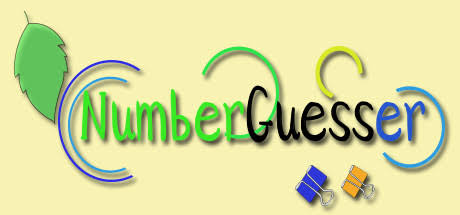

<h1 align="center">🎯 Number Guesser</h1>

<p align="center">
  
</p>

<p align="center">
  A simple number guessing game in Python with user accounts, scoring, and game history.
</p>


## ✨ Features

- 🔐 Sign up and log in with a username and password
- 🛡️ Passwords stored as salted PBKDF2-SHA256 hashes (never in plain text)
- 🎚️ Three difficulty levels
- 🏆 Score for each game
- 📜 Game history for each player

## 🎮 Difficulty levels

| Level | Range | Score formula |
|-------|-------|---------------|
| Easy | 1 – 1,000 | `5000 × 1 − guesses × 100` |
| Medium | 1,000 – 10,000 | `5000 × 2 − guesses × 100` |
| Hard | 1 – 100,000 | `5000 × 3 − guesses × 100` |

## Project structure

Number_Guesser/  
├── data/  
│   ├── LOGO_game.jpeg  
│   ├── players_info.txt  
│   └── results.txt  
├── src/   
│   ├── main.py  
│   ├── new_game.py  
│   ├── players.py  
│   └── results.py  
├── .gitignore  
├── LICENSE  
├── README.md  
└── requirements.txt  


## ⚙️ Requirements

- Python 3.10 or newer 
- No third-party packages are needed. The project uses only the standard library.

## 🚀 How to run

From the **`Number_Guesser`** folder (the project root):

```bash
cd src
python main.py
```
If you are in the Git repository root (`Python-Projects-Portfolio`), run:

```bash
cd Number_Guesser/src
python main.py
```

## 🔑 Account rules

- **Username:** 3 to 20 characters, letters, digits, and underscores only. Usernames must be unique.
- **Password:** at least 8 characters, with at least one letter and one digit.

## 📝 Notes

> `players_info.txt` and `results.txt` are created automatically when you sign up or finish a game.


## 📄 License

This project is licensed under the terms in the [LICENSE](../LICENSE) file.

