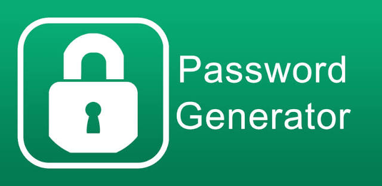

# Password Toolkit

A small Python toolkit for generating random passwords, memorable passphrases, and numeric PIN codes.



## Features

- **Random passwords** with a configurable length, numbers, and symbols. Every selected character group is guaranteed to appear at least once.
- **Memorable passphrases** made of random words, with optional capitalization and a custom separator.
- **PIN codes** containing digits only.
- Uses Python's `secrets` module for cryptographically secure randomness.

## Installation

```bash
pip install -r requirements.txt
```

The default passphrase vocabulary comes from NLTK's word list. Download it once with:

```bash
python -c "import nltk; nltk.download('words')"
```

You can also pass your own list of words to `MemorablePasswordGenerator`.

## Usage

```python
from password_toolkit import (
    MemorablePasswordGenerator,
    PinCodeGenerator,
    RandomPasswordGenerator,
)

RandomPasswordGenerator(length=16, include_numbers=True, include_symbols=True).generate()
MemorablePasswordGenerator(num_of_words=4, separator="-", capitalization=True).generate()
PinCodeGenerator(length=6).generate()
```

## Running the tests

```bash
python -m pytest -v
```

## Project structure

```
Password_Toolkit/
├── data/
├── password_toolkit/
│   ├── __init__.py
│   └── generators.py
├── tests/
│   └── test_generators.py
├── pytest.ini
└── requirements.txt
```