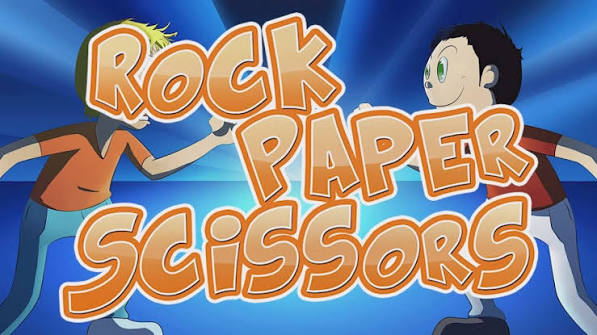
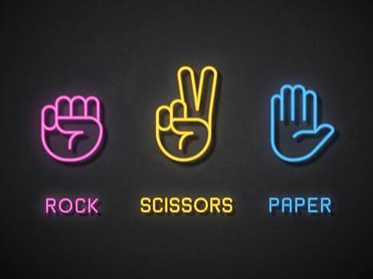

<h1 align="center">🪨 📄 ✂️ Rock Paper Scissors</h1>

<p align="center">
  
</p>

<p align="center">
  A console version of the classic Rock, Paper, Scissors game in Python. Play against the computer and track your score.
</p>

---

## ✨ Features

- 🤖 Play against a computer that chooses randomly
- ✅ Input validation: invalid choices are rejected and you are asked again
- 🏆 Score tracking: each win adds one point
- 🔁 Replay loop: play as many rounds as you like

## 🎮 Rules

| Your choice | Beats | Loses to |
|-------------|-------|----------|
| 🪨 Rock | ✂️ Scissors | 📄 Paper |
| 📄 Paper | 🪨 Rock | ✂️ Scissors |
| ✂️ Scissors | 📄 Paper | 🪨 Rock |

If both choices are the same, the round is a tie and no point is added.



## 📁 Project structure
Rock_Paper_Scissors/  
├── data/ 
| ├── image.jpeg 
│ └── LOGO.jpeg  
├── src/  
│ └── game.py  
├── LICENSE  
└── README.md  


## ⚙️ Requirements

- Python 3.13.2 or newer
- No third-party packages. Only the Python standard library is used.

## 🚀 How to run

From the project root:

```bash
cd src
python game.py
```

## 🧠 Concepts used

- Classes and objects (`RockPaperScissors`, `Player`)
- Recursion, for re-asking after an invalid input
- Type hints and docstrings

## 📄 License

This project is licensed under the terms in the [LICENSE](LICENSE) file.
